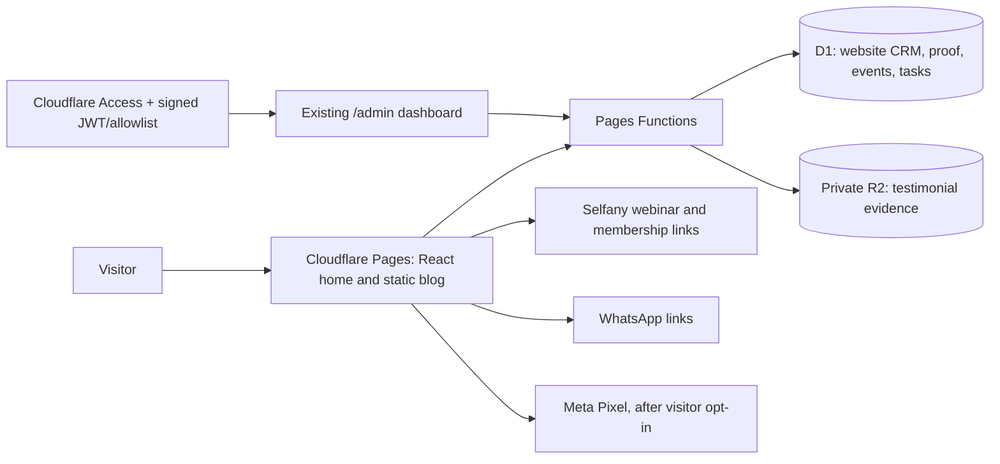

# DrHauwaPhD.ca architecture

**Snapshot:** 18 November 2026. The production site is a Git-connected Cloudflare Pages project named `dwn`, serving `drhauwaphd.ca` and `www.drhauwaphd.ca`.

## Environments and trust boundaries

- Cloudflare Pages preview binds `DB` to `dwn-growth-staging` and `TESTIMONIAL_IMAGES` to `dwn-testimonials-staging`. Production binds separate `dwn-growth-production` and `dwn-testimonials-production` resources. Public build output is `dist`, generated by `npm run build`.
- `/api/leads` validates JSON, origin, Turnstile, request ID, and rate limits before writing a contact and CRM event. The same contact can have multiple submissions. A consultation submission also creates a consultation and a follow-up task. Existing consent/suppression rules remain enforced.
- `/api/unsubscribe` validates Turnstile, origin, and rate limit, then suppresses the address and clears website marketing consent. This does not change Selfany subscriptions or purchases.
- `/api/outbound` records anonymous, consented website clicks with destination, placement, path, and UTMs. It records no Selfany outcome or payment data.
- `/api/testimonials` serves approved D1 records; image delivery is restricted by approved evidence references and a public allowlist. Source screenshots remain in private R2.
- `/admin/` and `/api/admin/*` are covered by Cloudflare Access. Admin APIs also verify the Access JWT and permitted email. The dashboard can review contacts, leads, tasks, consultations, proof, referral links, and website event reports. It does not operate Selfany.
- `migrations/0001_crm.sql`, `0002_testimonials.sql`, and `0003_growth.sql` define the schema. The third migration adds lead profiles, follow-up tasks, and outbound events without removing existing tables.

## External systems

Selfany owns webinar registration, paid membership, fulfillment, and transactions. The website links to the verified `selfany.com` webinar and membership URLs. There is no API, webhook, CSV, Zapier, checkout, or membership sync. WhatsApp links are also external. The email sender, GA4, Search Console, ad accounts, and Workers AI binding are not connected to the website CRM.

## Build and release

Run `npm ci`, `npm run test:crm`, `npm run test:blog`, `npx tsc --noEmit`, and `npm run build`. Apply additive D1 migrations to staging, validate a preview Pages deployment, then apply to production before the production Pages release. The tracked historical `dist` and `node_modules` trees are not the source of truth; the Pages build uses the source and lockfile.
