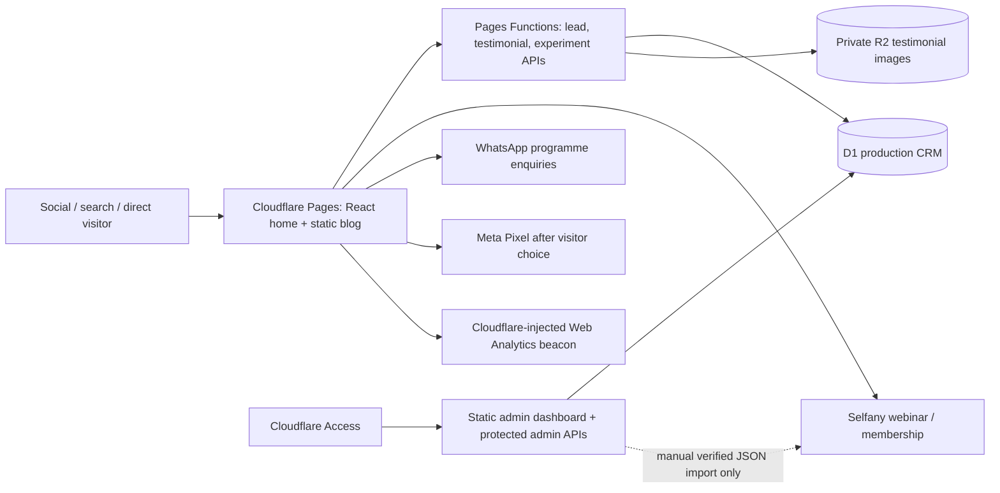

# DrHauwaPhD.ca — current system audit

**Audit snapshot:** 18 November 2026, approximately 06:24 UTC. **Scope:** read-only review of the current repository, public site, Cloudflare Pages configuration, production and staging D1 counts, public APIs, Selfany destinations, supplied account screenshots, and local tests. No lead, order, experiment, configuration, or deployment was created or changed during this audit.

## How to read the findings

- **Verified live** means I observed the deployed endpoint, DNS, Cloudflare configuration, or a read-only database query in this audit.
- **Implemented in code** means the route or UI exists and the relevant logic was inspected; it does not prove a real visitor has completed the flow.
- **Untested** means the feature may work, but an authenticated session, valid Turnstile challenge, real Selfany export, or measured visitor traffic was unavailable for a fresh end-to-end test.
- **Missing/disconnected** means the current project has no working connection or process for that capability.

The latest successful production Pages deployment is Git commit `36aa39f4f32671eee14575199132644d6f746e88` on `main`, matching this checkout's HEAD (`36aa39f`). The older claims in `IMPLEMENTATION_PLAN.md`, `.agents/product-marketing.md`, and parts of `GROWTH_SYSTEM_RUNBOOK.md` describe earlier implementation stages; current code, deployment configuration, and live responses take precedence.

## 1. Architecture and implemented features

| Component | Current state | Evidence |
| --- | --- | --- |
| Hosting | Git-connected Cloudflare Pages project `dwn`; `npm run build` produces `dist`; production domains are apex and `www`; preview branches enabled. | Read-only Pages project/deployment API; `package.json`, `vite.config.ts`. |
| Front end | Vite/React single-page home with founder positioning, DWN section, programme cards, quiz, newsletter form, testimonials, videos, WhatsApp, and Selfany CTAs. | `src/App.tsx`, `src/components/*`; live home HTTP 200. |
| Content/SEO | One static blog article plus blog index, sitemap, robots file, local images, and article schema. | `content/build-wealth-as-an-immigrant-in-canada.md`, `scripts/build-blog.mjs`, live blog/sitemap HTTP 200. |
| Data | Separate D1 production (`dwn-growth-production`) and staging (`dwn-growth-staging`), each with CRM and testimonial migrations. | Pages `DB` bindings and read-only D1 queries; `migrations/0001_crm.sql`, `0002_testimonials.sql`. |
| Images | Separate private R2 buckets are bound as `TESTIMONIAL_IMAGES`; public API serves an approved, allowlisted source screenshot. | Pages bindings; `/api/testimonial-images/dwn-pdf-03` HTTP 200, restricted page 08 HTTP 404; `server/testimonialEvidence.mjs`. |
| Administration | Static `/admin/` dashboard protected by Cloudflare Access; API also validates Access JWT issuer, audience, signature, expiry, and allowed email. | Unauthenticated `/admin/` and `/api/admin/overview` redirect to Access; production Pages has Access variables; `server/access.mjs`. |
| Form protection | Production health reports D1 intake and Turnstile configured. API has origin, JSON/body validation, honeypot, challenge verification, and D1-based rate limit. | Live `/api/health`; `functions/api/leads.js`, `server/crm.mjs`. A fresh valid submission was **not** made in this read-only audit. |
| External sales | Webinar, membership payment, fulfilment, and customer records remain on Selfany. Website uses outbound links; CRM has a manual import path. | Live Selfany destinations HTTP 200; `src/components/DWNSection.tsx`, `server/import.mjs`, admin UI. |

The production D1 snapshot contained **21 testimonials and zero contacts, CRM events, webinar registrations, memberships, consultations, referrals, suppressions, automation logs, testimonial experiment events, and audit logs**. Staging contained 21 testimonials, one contact/CRM event, and two experiment events. These are database counts, not a statement that the Selfany business has no customers or sales. Prior user-supplied Selfany screenshots show its own sales dashboard and CSV/PDF export, which are outside this D1 database.

## 2. What works, what is incomplete, and what is broken

| Status | Finding | Evidence / practical limit |
| --- | --- | --- |
| **Verified live** | Apex and `www` homepages, blog index, article, sitemap, health API, testimonial API, Selfany webinar/membership destinations, and one permitted screenshot respond. Public API returns 21 approved testimonials. | HTTP GET checks on 18 Nov 2026; `www` is a separate 200 response with canonical pointing to apex, not a redirect. |
| **Verified live** | An unauthenticated visitor is sent to Cloudflare Access for `/admin/` and `/api/admin/overview`; ordinary home remains public. | HTTP redirect checks. The current policy's email rule and a signed-in dashboard session were not independently retested here. |
| **Implemented; previously smoke-tested** | Lead persistence, duplicate handling, consent/suppression, referrals, admin import, and experiment event storage have local tests and prior runbook smoke checks. | `tests/crm.test.mjs`, `GROWTH_SYSTEM_RUNBOOK.md`; current production tables are empty except testimonials, so actual operating volume is unproven. |
| **Incomplete** | The admin's webinar, membership, advertising, SEO, and email sections mainly state that their integrations are unavailable. They are useful status displays, not operating dashboards for those channels. | `public/admin/index.html`, `functions/api/admin/overview.js`. |
| **Broken** | “Connect With Dr. Hauwa” points to `#contact`, but no `id="contact"` exists; footer Privacy, Terms, Cookies, and one ecosystem CTA point to `#`. | `src/components/FinalCTA.tsx`, `Footer.tsx`, `Ecosystem.tsx`; repository-wide anchor search. |
| **Broken / not ready** | `members.drhauwaphd.ca` resolves to `cname.selfany.com`, but HTTPS failed its TLS handshake in this audit. Selfany's user-supplied domain screen showed pending verification. The site currently links to working `selfany.com` URLs, so this does not break the present purchase links. | DNS lookup and HTTPS request; supplied Selfany custom-domain screenshot. |
| **Out of date artifact** | Checked-in `dist/index.html` contains an old unconditional Meta Pixel and placeholder Google Ads tag; the live home HTML and current `index.html` do not. Cloudflare's current Git build is authoritative. Avoid using checked-in `dist` to judge live tracking or as a deployment source. | `dist/index.html` versus live home HTML, production deployment commit. |

### Local verification

- `npm run test:blog`: **passed** (content, metadata, schema, assets, sitemap).
- `npx tsc --noEmit`: **passed**.
- `npm run test:crm`: **10 passed, 1 failed**. The failing test filters contacts to **17 Nov 2026**, while its newly imported contact receives the current audit date **18 Nov 2026** (`tests/crm.test.mjs:183-185`, `server/import.mjs:20-25`). This is a date-sensitive test fixture, not evidence that live contact filtering is broken. No code was changed to make the test pass.

## 3. Customer journey and acquisition

| Journey | Actual path | What the website can measure now | Gap |
| --- | --- | --- | --- |
| Discovery | Founder social links (Facebook, Instagram, TikTok), search to one blog article, direct traffic, and WhatsApp links. | UTM source/medium/campaign only when a site form is submitted; Cloudflare beacon is present on the live home. | No connected source-to-sale reporting, Search Console data, channel baseline, or documented campaign performance. Blog-to-home CTAs do not retain query parameters. |
| Free webinar | Home CTA opens `https://selfany.com/w/DrHauwaPhD1`. | The DWN section records a first-party outbound click in the testimonial experiment; other webinar links are not tracked by that experiment. | Click is not registration/attendance. No automatic Selfany registration event or email follow-up reaches D1. |
| DWN enquiry | Hero/header/final “Join” anchors open a drawer asking for name/email. Successful API response says “Your enquiry was saved.” | D1 can record a `community` lead, marketing-consent choice, first UTM, and valid referral code. Meta `Lead` fires only after successful save and only if visitor accepted tracking. | “Join” can sound like paid membership, but this action only saves an enquiry. No notification, follow-up email, or qualification workflow is connected. |
| Paid membership | DWN section and testimonials link to `https://selfany.com/thedwn`; Selfany manages checkout/access. | DWN section records outbound clicks, not purchase. Manual admin import can enter verified sale/renewal/refund/cancellation records later. | No real-time purchase signal, cross-domain attribution, automated reconciliation, or proven website-to-sale conversion rate. |
| Newsletter | Form saves a consented `newsletter` lead. | Confirmed D1 save can emit Meta `Lead` after visitor tracking consent. | Resend/templates are disconnected: no welcome issue, newsletter delivery, or self-service unsubscribe despite the form's unsubscribe promise. |
| Quiz | Two-question choice flow plus email/consent saves a `pathway_quiz` lead. | Interest and obstacle are written into a CRM event's JSON details. | Admin contact list does not show those answers; no tailored next step or sequence. This is deterministic branching, not an AI recommendation engine. |
| Consulting/programmes | Programme cards open WhatsApp with preset text. Final “Connect” anchor is broken. | One drawer WhatsApp link emits a client-side `Contact` event if tracking is active; programme-card WhatsApp clicks have no first-party CRM event. | No website consultation form calls `source: 'consultation'`; D1 pipeline can only populate if that source is sent by some other client. No booking or won-revenue reconciliation. |

The site has useful acquisition assets—one substantive article, two founder videos, social links, a free webinar, an email opt-in, and 21 approved member quotes. It does **not** yet have a measurable acquisition-to-purchase loop. Its referral mechanism is an admin-created code for an existing D1 contact; a `?ref=` code is recorded only on a successful website lead submission. It is not passed to Selfany checkout. Production has zero referral codes and conversions.

## 4. CRM and admin dashboard assessment

**Implemented data model.** `migrations/0001_crm.sql` defines contacts, deduplicated CRM events, webinar registrations/attendance, membership events, consultation stages and evidence-backed revenue, referrals/conversions, suppressions, automation logs, audit logs, and rate limits. `0002_testimonials.sql` adds testimonial experiment events and 21 approved quotes. First UTM fields are kept on contacts; event details hold quiz choices and referral codes. This is a sensible starting schema, not a duplicate checkout system.

**Admin functions.** `public/admin/app.js` loads overview counts, filterable contacts (up to 100), export of only the visible 100 rows, consultation stages, referral codes, testimonials, 30-day proof click rates, audit log, and a manual Selfany import box. API routes enforce admin JWTs; a reviewer role exists in code but no `REVIEWER_EMAILS` variable is present in the production Pages configuration. Testimonials can be drafted, approved/rejected, and withdrawn from the public API. The public site shows six initially and category filters; 17 IDs permit public evidence screenshots, while four quoted pages deliberately have private source images.

**Data-flow limits.** The import accepts 1–100 *already mapped JSON rows* and an administrator's verification checkbox; it is not a direct CSV parser or a Selfany connector. It validates event type, stable external ID, timestamp, and monetary fields, and deduplicates repeated imports. The dashboard does not show a full contact timeline, quiz details, owner/next action, task reminders, cohort retention, or source-to-sale attribution. Its consultation pipeline has no originating form on the current site. Revenue only appears after verified Selfany imports or a manually marked won consultation with amount/currency/evidence. Zero production events means none of these metrics currently demonstrate real conversion performance.

**Security and operational limits.** Access and JWT checking are layered correctly; public lead endpoints require Turnstile in production. The dashboard's public route is protected, but current signed-in UI behavior was not retested in this audit. Admin pages rely on client JavaScript to render; the API remains the actual authorization boundary. No scheduled worker, queue consumer, email sender, or automation-log writer appears in this project. An empty automation log reflects no runs, not an automation success metric.

## 5. Selfany: separate platform and realistic measurement

The current site uses **ordinary outbound links** to Selfany's webinar and membership pages. It does not embed Selfany checkout, send a website contact directly into Selfany, receive a webhook, or read Selfany account sales through an API. The website's `members.drhauwaphd.ca` CNAME has not become a usable HTTPS destination, and the site does not link to it.

The supplied Selfany account screenshots show a Sales History area with CSV/PDF export and an Integrations page (including Meta/TikTok tracking and email tools). [Selfany's own FAQ](https://www.support.selfany.com/blog/selfany-master-faq) describes supported integration categories and Zapier; this public information does **not** establish that this account exposes a documented purchase/attendance webhook or that any listed integration is connected. The only defensible measurement today is: website lead saved in D1, outbound click on two tracked CTAs, and a separately verified Selfany sale/registration visible in Selfany. A D1 sale or registration requires an authorized manual import with stable IDs. The Selfany dashboard itself remains the source of truth for payment and access.

## 6. Analytics, AI, and automation inventory

| Capability | Assessment |
| --- | --- |
| First-party tracking | UTM fields, referral code on lead save, and a quote/no-quote experiment endpoint exist. Experiment assigns a persistent per-browser variant and logs an exposure at the relevant CTA plus outbound click, deduplicated by session. Production has zero events; no winner or click rate can be inferred. Other CTAs and actual Selfany outcomes are outside the experiment. |
| Meta | Current client contains Pixel ID and loads it only after the visitor chooses “Allow tracking”; `Lead` is fired after confirmed website save. No verified Meta Events Manager receipt, CAPI, Ads reporting API, or account-side conversion configuration was available. |
| Cloudflare Web Analytics | The **live HTML contains a Cloudflare-injected beacon**, despite the Pages project `web_analytics_tag` field being null. That proves a collection script is present, not that CRM reporting is connected or that analytics data quality is verified. Admin overview currently says Cloudflare Analytics is not connected. |
| GA4 / Google Ads / Search Console | No current GA4 or Google Ads tag in live home HTML/current source and no connected admin reads. The placeholder Ads tag exists only in stale checked-in `dist/index.html`. Search Console access/coverage was not available. |
| Email / follow-ups | Consent and suppression records exist, but no sender, approved templates, welcome message, webinar reminder, lead response, unsubscribe endpoint, or scheduled send workflow is implemented. |
| AI | The site discusses AI and has AI-related testimonial categories, but no model calls, AI agent, prompt pipeline, n8n/Make workflow, or automated content production is in the deployed project. The quiz is fixed-choice logic. |
| Ads / affiliates | No Meta Marketing API, campaign budget controls, or ad-spend integration. Site referral codes are separate from any Selfany affiliate system; rewards and purchases are not synced. |

## 7. Website quality audit

**Performance.** The live home serves about **399 KB of uncompressed JavaScript** and **39 KB CSS**; the repository has two local MP4 files of **11.47 MB** and **7.60 MB**. Videos are not autoplayed, but the player does not set an explicit `preload="none"`. The home deliberately displays a roughly two-second preloader followed by an exit animation; this delays interaction even if content is ready. Google Fonts and several external Unsplash images add third-party dependencies. These are concrete optimization opportunities, **not measured Core Web Vitals**; no Lighthouse/CrUX run or real-user performance dataset was available.

**Technical SEO.** The article and blog index return crawlable HTML with unique titles, descriptions, canonicals; the article has BlogPosting/breadcrumb/person/organization schema, byline, official-resource links, and a sitemap entry. `npm run test:blog` passed. The home responds with an empty React root, no server-rendered H1, and only basic title/description/canonical in its initial HTML; social metadata and Person schema are injected later by React Helmet. JavaScript-capable crawlers may render them, but this is weaker than the blog's initial HTML. Both apex and `www` return 200 with the same canonical, without a `www` redirect. Only one article is published, so topical coverage and internal linking are limited. Cloudflare adds managed robots content to the live `robots.txt`; the site's own sitemap remains discoverable.

**Security/privacy.** HTTP redirects to HTTPS. Public JSON responses use `no-store` and `nosniff`; R2 originals are private and the image endpoint checks approval plus an allowlist. The lead API validates origin, payload, Turnstile and rate limit. Unauthenticated admin URLs redirect to Access, and the admin API performs JWT verification itself. Live home/blog responses did not show `Strict-Transport-Security`, `Content-Security-Policy`, `X-Frame-Options`, or `Permissions-Policy` headers in this spot check. This is a hardening opportunity, not a penetration-test finding. Privacy/Terms/Cookies links currently go nowhere, and the email form promises unsubscribe without a recipient-facing method.

**Accessibility.** The static blog has a working skip-link pattern and semantic article headings. The React home has no comparable skip link. The drawer and quiz visually behave as modals but lack `role="dialog"`, `aria-modal`, focus trapping/return, and Escape-key handling in the inspected components. Motion-heavy preloader/scroll effects have no explicit reduced-motion path in the inspected code. No automated accessibility scan or assistive-technology session was run, so these are code-observed risks requiring user testing.

**Conversion design.** Approved member experiences appear near DWN calls to action, with a clear “member-reported; outcomes vary” caveat. The offer on the home is broad across careers, property, digital business, technology, branding, and community; paid tier details, price, expected process, and the next step are not explained on the site before a visitor leaves for Selfany. Multiple “Join” CTAs open a lead drawer rather than checkout, and the broken `#contact` link blocks one consultation path. The testimonial catalogue includes achievement labels from `content/testimonials.json`; some labels add context not stated in the displayed quote itself, so they should be checked against the approved source page before being treated as stand-alone claims. No actual conversion lift has been measured.

## 8. Comparison with the requested growth methods

This comparison uses [Acquisition.com's own Offers/Leads/Money Models training descriptions](https://www.acquisition.com/training) and [its value checklist](https://www.acquisition.com/hubfs/Offer%20Checklists%20-%20PDF%20Downloads/Pricing-Value-Checklist.pdf?hsLang=en), plus [Sabrina Ramonov's documented AI automation workflow](https://www.sabrina.dev/p/build-your-first-ai-automation) and [content-repurposing example](https://content.sabrina.dev/). They are planning lenses, not evidence that a tactic would work for DWN without a measured baseline.

| Principle | Existing strength | Current gap / practical opportunity |
| --- | --- | --- |
| Hormozi: specific offer and reduced uncertainty | Real community, credible founder context, 21 approved quotes, free webinar and paid Selfany product. | Home does not make the exact membership package, tier/pricing, support level, effort, and next action clear. Verify terms on Selfany and explain them accurately on the site; do not invent guarantees or earnings expectations. |
| Hormozi: acquire qualified leads through content, lead magnets, referrals | Article, video, social links, free webinar, quiz, and referral-code schema exist. | No connected registration/purchase outcomes; referral codes unused in production; quiz answers are not followed up. Prioritize measurement and follow-up before scaling traffic or testing ad spend. |
| Hormozi: monetize and retain with matched offers | Selfany already owns checkout and membership access; WhatsApp handles service enquiries. | No website-to-Selfany order reconciliation, consultation booking path, or visibility into renewals/cancellations in D1. Improve the existing handoffs and import discipline before adding more offer layers. |
| Ramonov: one original source repurposed into channel-specific content with automation and review | Founder videos and long-form article provide source material. | No production AI/content workflow, approval queue, publishing schedule, or source-to-lead tracking. A later small, human-reviewed repurposing workflow could use these assets; adding AI now would not fix the broken funnel or missing measurement. |

## 9. Priority recommendations for the implementation plan

| Priority | Action to plan | Why it comes first | Preserve / improve / add |
| --- | --- | --- | --- |
| **P0 — fix known breaks** | Repair `#contact` and placeholder legal/navigation links; decide whether consultation should lead to a tracked enquiry, booking, or WhatsApp. Make “Join DWN” distinguish enquiry from paid membership. | Removes dead ends and misleading next steps without replacing the site or Selfany. | **Improve** existing navigation and CTAs. |
| **P0 — close the measurement gap** | Confirm an account-level Selfany export/event contract, then reconcile webinar registrations, purchases, renewals, and refunds into the existing idempotent D1 import. Define one source of truth and event IDs. | Production D1 currently has zero sales/registration events; a click must not be reported as a sale. | **Preserve** Selfany checkout and the D1 schema; **improve** their handoff. |
| **P1 — activate lead response** | Establish who follows up on each saved enquiry, where replies go, and the service-level target. If email is used, connect a sender, approved templates, and a working unsubscribe before launching a sequence. | Current forms collect interest but produce no delivery or response workflow. | **Improve** the existing CRM; **add** follow-up only where needed. |
| **P1 — make evidence usable** | Surface quiz interest/obstacle and contact history to the operator; import confirmed Selfany records; establish a baseline by channel and closed time window. | Enables useful segmentation and avoids optimizing on zero or partial data. | **Improve** admin reporting. |
| **P1 — repair domain/trust** | Resolve Selfany's pending `members` verification/TLS only if the branded domain is desired; keep current working links until it works. Publish real Privacy/Terms/Cookies destinations and align the email promise with actual unsubscribe handling. | A broken branded domain and dead trust links can deter visitors. | **Preserve** live Selfany links; **improve** trust and domain setup. |
| **P2 — performance/accessibility/SEO** | Remove or shorten the preloader, test video loading and Core Web Vitals, ensure homepage metadata exists in initial HTML, add modal keyboard/focus behavior and reduced-motion support, then test mobile and assistive technology. | Real usability and crawlability improvements; verify with measurements before claiming gains. | **Improve** existing site. |
| **P2 — controlled growth experiments** | Once outcome data exists, measure the quote variant against a defined primary conversion metric and enough traffic. Extend reliable outbound tracking to important CTAs, and compare content/referral channels on qualified leads and verified sales. | Current experiment has zero production events and only click outcomes. | **Preserve** the experiment scaffold; **improve** its outcome link and analysis. |
| **P3 — AI/content scale** | After follow-up and attribution work, pilot a reviewed article/video-to-social repurposing workflow and measure qualified visits/leads, using the founder's real source material. | Automation can amplify working content, but it cannot substitute for offer clarity or conversion evidence. | **Add** a small workflow later; no rebuild required. |

**Preserve:** Git-connected Pages deployment, separate production/staging D1 and R2, Access plus JWT admin protection, Turnstile-guarded lead intake, consent/suppression fields, approved testimonial archive and private-image controls, Selfany as checkout/access source of truth, and the static SEO blog.

**Improve:** broken links, wording and routing of CTAs, practical CRM visibility, Selfany reconciliation, newsletter/unsubscribe handling, homepage crawlability, measured performance and accessibility, and documentation that still describes the pre-CRM state.

**Add only after the basics work:** verified event-based follow-up, meaningful end-to-end analytics, a Selfany-supported automated sync if its account contract permits one, and a small reviewed AI content workflow.

## Where the project stands

The website and supporting Cloudflare infrastructure are deployed and largely functional as a **content, lead-capture, and testimonial platform**. The production CRM is structurally ready but contains no lead, registration, membership, or consultation activity at this snapshot; Selfany remains separate. The first work should be to fix the dead consultation/trust links and make the DWN call to action honest and clear, then connect **verified Selfany outcomes and lead follow-up** to the systems already built. Performance, accessibility, broader SEO, A/B interpretation, and AI automation should follow a measurable customer journey.
